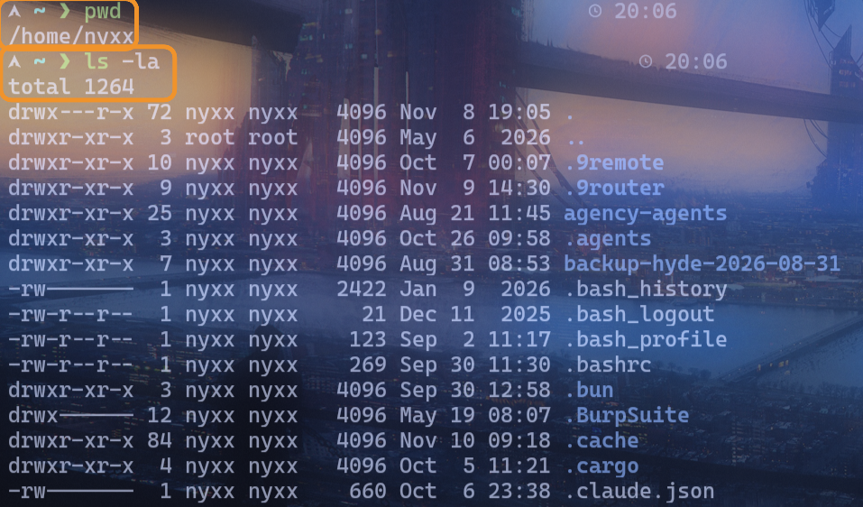
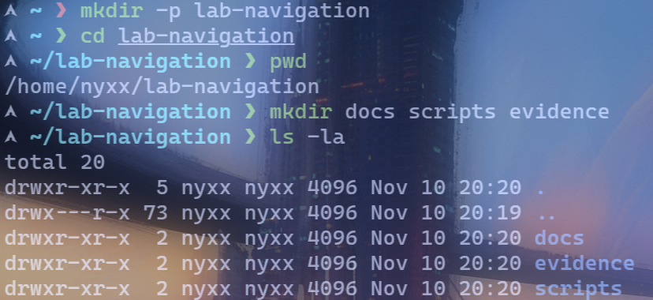
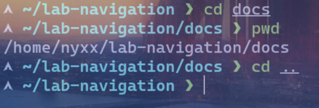
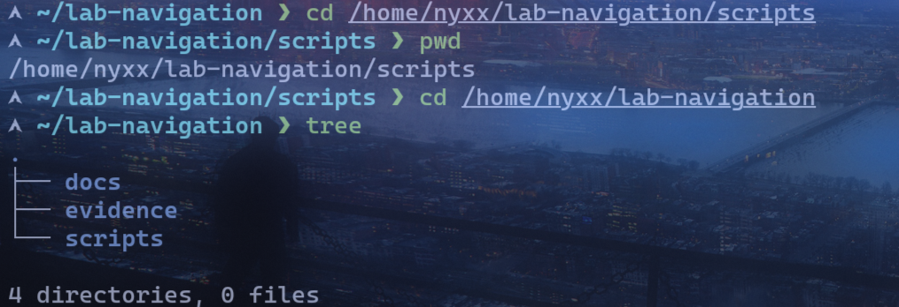

# Lab 01: Directory Navigation

## Objective
Memahami dan mempraktikkan perintah navigasi direktori dasar di Linux.

## Environment
- OS: Arch Linux
- Kernel: 7.2.11-arch1-1
- Shell: zsh
- Interface: Terminal
- User: nyxx

## Practical Implementation
```bash
# Cek lokasi saat ini
pwd

# Lihat isi direktori (detail + tersembunyi)
ls -la

# Buat direktori latihan
mkdir -p lab-navigation
cd lab-navigation
pwd

# Buat subdirektori
mkdir docs scripts evidence
ls -la

# Pindah dengan relative path
cd docs
pwd
cd ..

# Pindah dengan absolute path
cd /home/nyxx/lab-navigation/scripts
pwd
cd /home/nyxx/lab-navigation

# Lihat struktur pohon
tree
```

## Expected Result
Terminal menunjukkan perpindahan antar direktori menggunakan `pwd`, `cd`, `mkdir`, dan `tree`, dengan path yang benar di setiap langkah.

## Analysis
- `pwd` menampilkan current working directory (absolute path).
- `ls -la` menampilkan semua file termasuk tersembunyi dengan detail permission, owner, ukuran, dan waktu.
- `mkdir -p` membuat direktori secara rekursif tanpa error jika parent sudah ada.
- `cd` tanpa argumen kembali ke home directory (`/home/nyxx`).
- Relative path (`docs`, `..`) lebih fleksibel, absolute path (`/home/nyxx/...`) lebih eksplisit.
- `tree` menampilkan struktur direktori dalam bentuk pohon.

## Evidence
Screenshot praktik aslinya sudah tersimpan di folder `evidence/`:
- 
- 
- 
- 

## Conclusion
Praktik successfully menunjukkan penggunaan perintah navigasi dasar (`pwd`, `ls`, `cd`, `mkdir`, `tree`) untuk berpindah dan menjelajahi struktur direktori di Linux.
