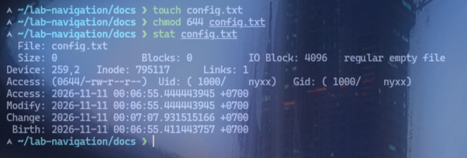
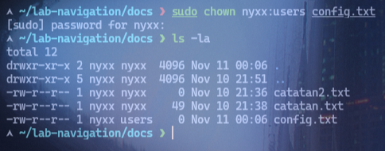
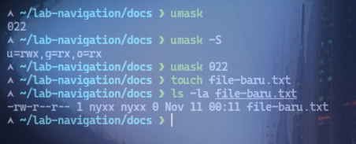

# Lab 04: Linux File Permissions

## Objective
Memahami dan mempraktikkan pengelolaan permission pada file Linux.

## Environment
- OS: Arch Linux
- Kernel: 7.2.11-arch1-1
- Shell: zsh
- Interface: Terminal
- User: nyxx

## Practical Implementation
```bash
# Buat file contoh
touch config.txt

# Ubah permission ke 644 (rw-r--r--)
chmod 644 config.txt

# Verifikasi dengan stat
stat config.txt

# Contoh permission berbeda
chmod 755 config.txt   # rwxr-xr-x
chmod 600 config.txt   # rw-------
chmod 777 config.txt   # rwxrwxrwx (berbahaya)

# Ubah owner dan group
chown nyxx:users config.txt
ls -la config.txt

# Cek dan ubah umask
umask
umask -S
umask 022
touch file-baru.txt
ls -la file-baru.txt
```

## Expected Result
File memiliki permission `-rw-r--r--`, owner adalah `nyxx`, dan `stat` menampilkan detail permission dalam format symbolik dan octal.

## Analysis
- Owner memiliki hak baca (`r`) dan tulis (`w`), sedangkan group dan others hanya memiliki hak baca (`r`).
- Nilai octal 644 = owner:6 (rw-), group:4 (r--), others:4 (r--).
- `chmod 777` memberikan aksi penuh ke semua user — berbahaya, hindari di produksi.
- `chown` mengubah owner dan group file, `umask` menentukan permission default untuk file baru.
- Permission file (tanpa `x`) vs direktori (membutuhkan `x` untuk masuk).

## Evidence
Screenshot praktik aslinya sudah tersimpan di folder `evidence/`:
- 
- 
- 

## Conclusion
Praktik successfully menunjukkan perubahan permission menggunakan `chmod` dan verifikasi menggunakan `stat`, serta pemahaman tentang `chown`, `umask`, dan risiko `chmod 777`.