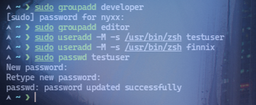
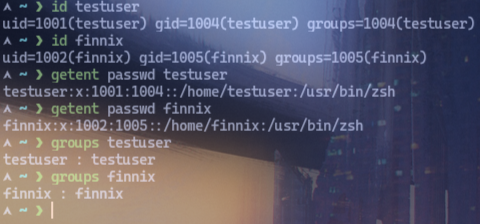
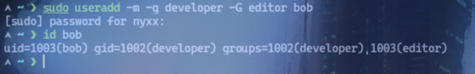

# Lab 01: User Management

## Objective
Membuat akun pengguna dan group melalui terminal Linux.

## Environment
- OS: Arch Linux
- Kernel: 7.2.11-arch1-1
- Shell: zsh
- Interface: Terminal
- User: nyxx (uid 1000, groups: nyxx, docker, wheel)

## Practical Implementation
```bash
# Buat group baru
sudo groupadd developer
sudo groupadd editor

# Buat pengguna baru (tanpa home, tanpa password dulu)
sudo useradd -M -s /usr/bin/zsh testuser
sudo useradd -M -s /usr/bin/zsh finnix

# Atau buat dengan home directory otomatis
sudo useradd -m -d /home/finnix -s /usr/bin/zsh finnix

# Set password
sudo passwd testuser
# (input password: test123)

# Lihat detail pengguna
id testuser
id finnix
getent passwd testuser
getent passwd finnix

# Lihat group milik pengguna
groups testuser
groups finnix

# Buat user dengan group langsung (primary group = username)
sudo useradd -m -g developer -G editor bob
id bob
```

## Expected Result
- Grup `developer` dan `editor` tercipta di `/etc/group`.
- Pengguna `testuser`, `alice`, dan `bob` tercipta di `/etc/passwd` dengan UID unik.
- `id` menunjukkan UID, GID, dan group sekunder masing-masing pengguna.

## Analysis
- `groupadd` membuat grup baru di `/etc/group`, GID diassign otomatis (>= 1000 untuk user groups).
- `useradd -M` buat user tanpa home directory, `-m` buat home directory otomatis.
- `-s` set login shell (zsh di environment ini).
- `-g` set primary group, `-G` set group sekunder (comma-separated).
- `passwd` mengatur password user (prompt interaktif).
- `id` menampilkan UID, GID, dan semua group tempat user tersebut.
- `getent passwd` mencari entry di database NSS (termasuk LDAP/LDAP if configured).

## Evidence
Screenshot praktik aslinya sudah tersimpan di folder `evidence/`:
- 
- 
- 

## Conclusion
Praktik successfully menunjukkan pembuatan grup dan pengguna baru (`groupadd`, `useradd`, `passwd`, `id`) beserta konfigurasi group dan shell.