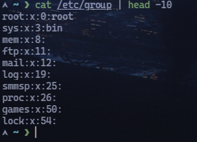
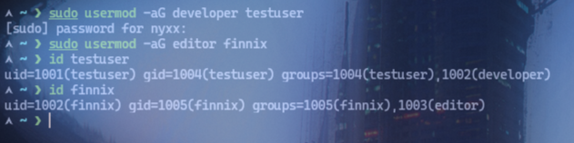
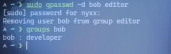
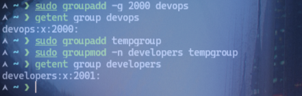

# Lab 02: Group Management

## Objective
Menambahkan pengguna ke group yang sesuai dan mengelola keanggotaan group.

## Environment
- OS: Arch Linux
- Kernel: 7.2.11-arch1-1
- Shell: zsh
- Interface: Terminal
- User: nyxx (uid 1000, groups: nyxx, docker, wheel)

## Practical Implementation
```bash
# Cek group yang ada
getent group | awk -F: '{print $1, $3, $4}'
cat /etc/group | head -10

# Tambahkan pengguna ke group (metode 1: usermod -aG)
sudo usermod -aG developer testuser
sudo usermod -aG editor finnix
id testuser
id finnix

# Tambahkan pengguna ke group (metode 2: gpasswd -a)
sudo gpasswd -a bob developer
sudo gpasswd -a bob editor
groups bob

# Hapus pengguna dari group
sudo gpasswd -d bob editor
groups bob

# Buat group baru dengan GID spesifik
sudo groupadd -g 2000 devops
getent group devops

# Ubah nama group
sudo groupadd tempgroup
sudo groupmod -n developers tempgroup
getent group developers
```

## Expected Result
- Pengguna `testuser`, `finnix`, dan `bob` masuk ke grup `developer` dan/atau `editor`.
- `id` dan `groups` menampilkan group sekunder yang sudah diperbarui.
- Grup `devops` dengan GID 2000 dan `developers` (rename dari `tempgroup`) tercipta.

## Analysis
- `usermod -aG group user` menambahkan user ke group sekunder (`-a` append, `-G` secondary groups).
- `gpasswd -a user group` alternatif lain untuk menambahkan anggota group.
- `gpasswd -d user group` mengeluarkan user dari group.
- `groupadd -g GID` membuat group dengan GID spesifik (jika default collision).
- `groupmod -n newname oldname` mengubah nama group.
- Group file: `/etc/group`, format: `name:password:GID:user1,user2,...`
- Primary group (GID di `id`) vs secondary groups (daftar group di `groups`).

## Evidence
Screenshot praktik aslinya sudah tersimpan di folder `evidence/`:
- 
- 
- 
- 

## Conclusion
Praktik successfully menunjukkan penambahan dan pengelolaan keanggotaan group (`usermod -aG`, `gpasswd -a/-d`, `groupadd -g`, `groupmod -n`) untuk mengatur akses berbasis group.