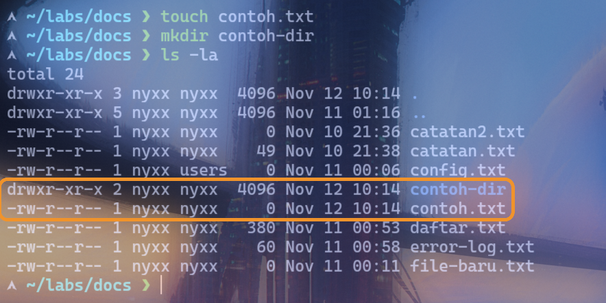
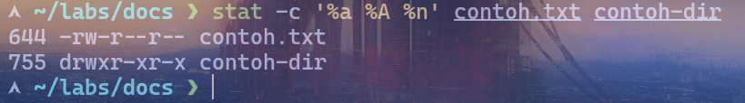
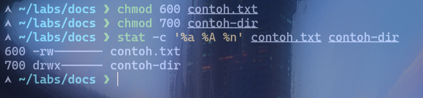

# Lab 03: Permission Fundamentals

## Objective
Memahami arti permission read (r), write (w), dan execute (x) bagi user, group, dan others.

## Environment
- OS: Arch Linux
- Kernel: 7.2.11-arch1-1
- Shell: zsh
- Interface: Terminal
- User: nyxx (uid 1000, groups: nyxx, docker, wheel)

## Practical Implementation
```bash
# Buat file dan direktori contoh
touch contoh.txt
mkdir contoh-dir
ls -la contoh.txt contoh-dir

# Lihat permission dalam octal
stat -c '%a %A %n' contoh.txt contoh-dir

# Penjelasan permission string:
# - rw- r-- r--
#   ↑    ↑    ↑
#  owner group others
# r = read (4), w = write (2), x = execute (1)

# Ubah permission ke berbagai kombinasi
chmod 644 contoh.txt   # rw-r--r--  (file default)
chmod 755 contoh-dir   # rwxr-xr-x  (direktori default)
chmod 600 contoh.txt   # rw-------  (hanya owner)
chmod 700 contoh-dir   # rwx------  (hanya owner)
chmod 777 contoh.txt   # rwxrwxrwx (semua orang) ⚠️ berbahaya
chmod 640 contoh.txt   # rw-r-----  (owner rw, group r)
chmod 660 contoh.txt   # rw-rw---  (owner rw, group rw)
chmod 620 contoh-dir   # rw--w----  (owner rw, group w+x)

# Verifikasi
stat -c '%a %A %n' contoh.txt contoh-dir
```

## Expected Result
File `contoh.txt` dan direktori `contoh-dir` memiliki permission yang berbeda tergantung dari `chmod` yang diterapkan. `stat` menampilkan nilai octal dan simbolik.

## Analysis
- **Read (r / 4)**: Baca file (cat, less) atau list direktori (ls).
- **Write (w / 2)**: Tulis/modify file (echo >, edit) atau buat/hapus file di direktori.
- **Execute (x / 1)**: Jalankan file (binary, script) atau masuk ke direktori (cd).
- **User (owner)**: Pengguna yang membuat file atau yang diatur oleh `chown`.
- **Group**: Anggota group primary atau secondary dari owner.
- **Others**: Semua pengguna yang bukan owner dan bukan anggota group.
- File biasa tanpa `x` (misal `644`), direktori butuh `x` untuk diakses (`755`).
- `chmod 777` memberikan aksi penuh ke semua user — berbahaya, hindari di produksi.

## Evidence
Screenshot praktik aslinya sudah tersimpan di folder `evidence/`:
- 
- 
- 

## Conclusion
Praktik successfully menunjukkan perbedaan arti `r`, `w`, `x` bagi user, group, dan others, serta cara mengubahnya dengan `chmod` dan memverifikasinya dengan `stat`.