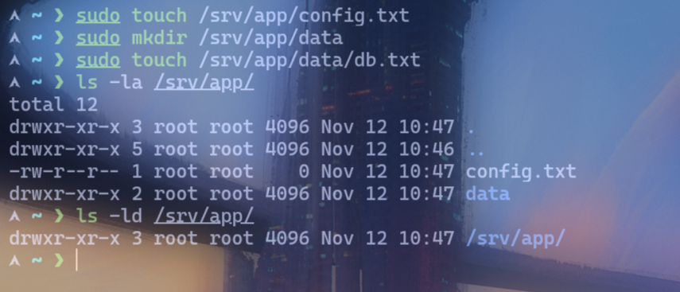
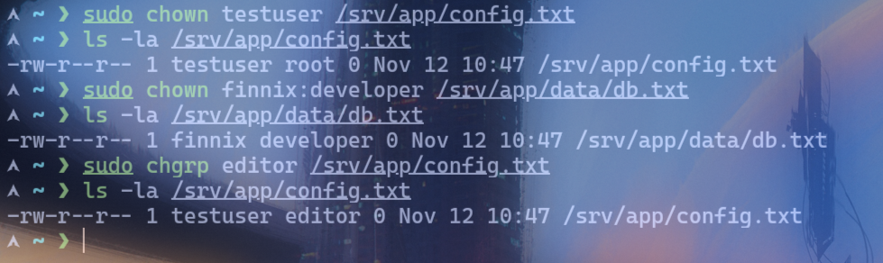
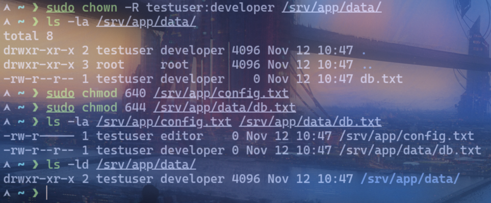

# Lab 04: Ownership Management

## Objective
Mengubah ownership dan permission file atau direktori sesuai kebutuhan.

## Environment
- OS: Arch Linux
- Kernel: 7.2.11-arch1-1
- Shell: zsh
- Interface: Terminal
- User: nyxx (uid 1000, groups: nyxx, docker, wheel)

## Practical Implementation
```bash
# Buat file dan direktori contoh
sudo touch /srv/app/config.txt
sudo mkdir /srv/app/data
sudo touch /srv/app/data/db.txt

# Cek ownership saat ini
ls -la /srv/app/
ls -ld /srv/app/

# Ubah owner file (chown)
sudo chown testuser /srv/app/config.txt
ls -la /srv/app/config.txt

# Ubah owner dan group sekaligus
sudo chown alice:developer /srv/app/data/db.txt
ls -la /srv/app/data/db.txt

# Ubah group saja (chgrp)
sudo chgrp editor /srv/app/config.txt
ls -la /srv/app/config.txt

# Ubah ownership semua file di direktori (rekursif)
sudo chown -R testuser:developer /srv/app/data/
ls -la /srv/app/data/

# Ubah permission sesuai kebutuhan
sudo chmod 640 /srv/app/config.txt   # owner rw, group r, others --
sudo chmod 750 /srv/app/data/        # owner rwx, group rx, others --
sudo chmod 644 /srv/app/data/db.txt   # file default aman
ls -la /srv/app/config.txt /srv/app/data/db.txt
ls -ld /srv/app/data/

# Cek umask (permission default file baru)
umask
umask -S
# Set umask 022 (default rw-r--r-- untuk file, rwxr-xr-x untuk dir)
umask 022
touch file-baru.txt
ls -la file-baru.txt
```

## Expected Result
- File `/srv/app/config.txt` milik `testuser` dan group `editor` dengan permission `640`.
- Direktori `/srv/app/data/` milik `testuser:developer` dengan permission `750`.
- File `db.txt` milik `alice:developer` dengan permission `644`.
- File baru `file-baru.txt` memiliki permission `644` (dipengaruhi `umask 022`).

## Analysis
- `chown user file` mengubah owner file.
- `chown user:group file` mengubah owner dan group sekaligus.
- `chgrp group file` mengubah group saja (singkatan dari `chown :group file`).
- `-R` rekrusif — berlaku untuk semua file dan subdirektori.
- `chmod 640`: owner rw, group r, others none — cocok untuk konfigasi internal.
- `chmod 750`: owner rwx, group rx, others none — direktori tim.
- `umask 022` adalah nilai umum: file jadi `644`, direktori jadi `755`.
- Owner file biasanya pembuat file, owner direktori biasanya pembuat direktori.

## Evidence
Screenshot praktik aslinya sudah tersimpan di folder `evidence/`:
- 
- 
- 

## Conclusion
Praktik successfully menunjukkan perubahan ownership (`chown`, `chgrp`) dan permission (`chmod`, `umask`) sesuai kebutuhan akses yang aman dan terkontrol.