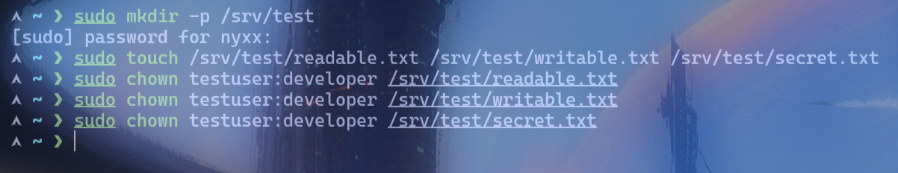
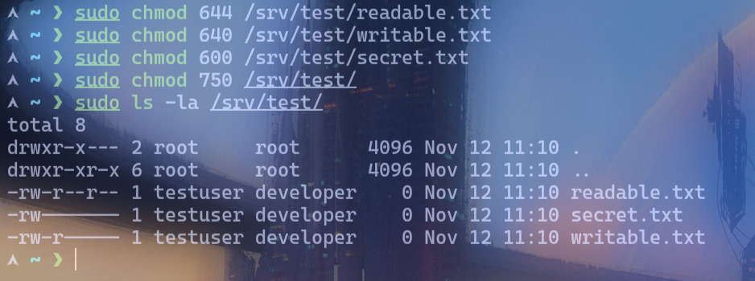
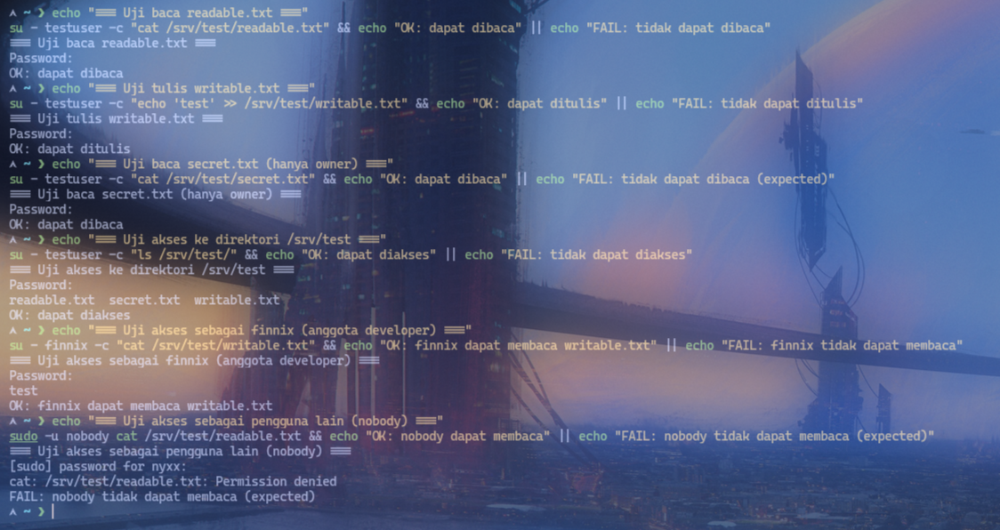

# Lab 05: Access Testing

## Objective
Menguji akses file/direktori menggunakan pengguna yang berbeda dan menjelaskan hasilnya.

## Environment
- OS: Arch Linux
- Kernel: 7.2.11-arch1-1
- Shell: zsh
- Interface: Terminal
- User: nyxx (uid 1000, groups: nyxx, docker, wheel)

## Practical Implementation
```bash
# Siapkan file dan direktori dengan permission berbeda
sudo mkdir -p /srv/test
sudo touch /srv/test/readable.txt /srv/test/writable.txt /srv/test/secret.txt

# Owner direktori HARUS di-set juga, kalau tidak tetap root:root
# dan testuser (others) keblokir di level folder, bukan di level file
sudo chown testuser:developer /srv/test
sudo chmod 750 /srv/test/                # rwxr-x--- (owner rwx, group rx, others none)

sudo chown testuser:developer /srv/test/readable.txt
sudo chown testuser:developer /srv/test/writable.txt
sudo chown testuser:developer /srv/test/secret.txt
sudo chmod 644 /srv/test/readable.txt   # rw-r--r--
sudo chmod 640 /srv/test/writable.txt    # rw-r-----
sudo chmod 600 /srv/test/secret.txt      # rw-------
sudo ls -la /srv/test/

# Uji akses sebagai testuser (su - testuser -c)
echo "=== Uji baca readable.txt ==="
su - testuser -c "cat /srv/test/readable.txt" && echo "OK: dapat dibaca" || echo "FAIL: tidak dapat dibaca"

echo "=== Uji tulis writable.txt ==="
su - testuser -c "echo 'test' >> /srv/test/writable.txt" && echo "OK: dapat ditulis" || echo "FAIL: tidak dapat ditulis"

echo "=== Uji baca secret.txt (hanya owner) ==="
su - testuser -c "cat /srv/test/secret.txt" && echo "OK: dapat dibaca" || echo "FAIL: tidak dapat dibaca (expected)"

echo "=== Uji akses ke direktori /srv/test ==="
su - testuser -c "ls /srv/test/" && echo "OK: dapat diakses" || echo "FAIL: tidak dapat diakses"

echo "=== Uji akses sebagai finnix (anggota developer) ==="
su - finnix -c "cat /srv/test/writable.txt" && echo "OK: finnix dapat membaca writable.txt" || echo "FAIL: finnix tidak dapat membaca"

echo "=== Uji akses sebagai pengguna lain (nobody) ==="
sudo -u nobody cat /srv/test/readable.txt && echo "OK: nobody dapat membaca" || echo "FAIL: nobody tidak dapat membaca (expected)"
```

## Expected Result
- `testuser` dapat membaca `readable.txt` (644 — world-readable).
- `testuser` dapat menulis ke `writable.txt` (640 — group-readable, owner-writable).
- `testuser` dapat membaca `secret.txt` (600 — owner-only, testuser adalah owner).
- `finnix` (anggota `developer`) dapat membaca `writable.txt` (640 — group-readable).
- `nobody` hanya dapat membaca `readable.txt` (644 — world-readable), tidak dapat mengakses `secret.txt` (600).

## Analysis
- `su - user -c` menjalankan perintah sebagai user lain dengan memasukkan password **user tersebut** di prompt.
- `sudo -u user command` menjalankan perintah sebagai user lain dengan password **user sendiri** — dipakai untuk `nobody` karena `su` ke `nobody` tidak mungkin (shell `nologin` dan password terkunci).
- ⚠️ Common mistake: lupa `chown` direktorinya. Kalau `/srv/test` tetap `root:root`, semua user selain root keblokir di level folder — semua test FAIL padahal permission file sudah benar.
- Permission `644` (rw-r--r--): semua orang bisa membaca, hanya owner yang bisa menulis.
- Permission `640` (rw-r-----): owner bisa rw, group bisa r, others tidak bisa apa-apa.
- Permission `600` (rw-------): hanya owner yang bisa membaca dan menulis.
- Permission direktori `750` (rwxr-xr-x): owner bisa rwx, group bisa rx, others tidak bisa masuk.
- Hasil testing membuktikan permission bekerja sesuai aturan user/group/others.
- `nobody` adalah user sistem (uid 65534) tanpa shell login, cocok untuk testing akses minimal.

## Evidence
Screenshot praktik aslinya sudah tersimpan di folder `evidence/`:
- 
- 
- 

## Conclusion
Praktik successfully menguji akses file dan direktori menggunakan pengguna yang berbeda (`sudo -u`) dan membuktikan bahwa permission (rwx) untuk user, group, dan others bekerja sesuai konfigurasi yang diatur.