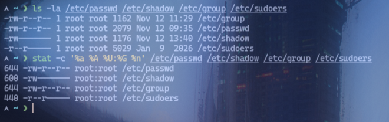
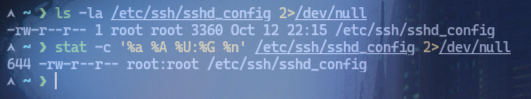
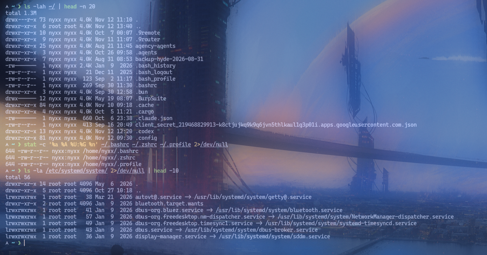

# Lab 06: Permission Analysis

## Objective
Menjelaskan alasan pemilihan konfigurasi hak akses yang digunakan.

## Environment
- OS: Arch Linux
- Kernel: 7.2.11-arch1-1
- Shell: zsh
- Interface: Terminal
- User: nyxx (uid 1000, groups: nyxx, docker, wheel)

## Practical Implementation
```bash
# Analisis file konfigurasi sistem
ls -la /etc/passwd /etc/shadow /etc/group /etc/sudoers
stat -c '%a %A %U:%G %n' /etc/passwd /etc/shadow /etc/group /etc/sudoers

# Analisis file konfigurasi aplikasi
ls -la /etc/ssh/sshd_config 2>/dev/null
stat -c '%a %A %U:%G %n' /etc/ssh/sshd_config 2>/dev/null

# Analisis home directory
ls -lah ~/ | head -n 20

# File konfigurasi shell
stat -c '%a %A %U:%G %n' ~/.bashrc ~/.zshrc ~/.profile 2>/dev/null

# Jalankan user-audit.sh untuk laporan lengkap
bash scripts/user-audit.sh

# Analisis service file
ls -la /etc/systemd/system/ 2>/dev/null | head -10
```

## Expected Result
- `/etc/passwd` (644 — world-readable, tidak boleh diubah).
- `/etc/shadow` (600 atau 640 — hanya root yang bisa baca).
- `/etc/sudoers` (440 — hanya root yang bisa baca/tulis).

## Analysis — Alasan Pemilihan Konfigurasi

| File / Direktori | Permission | Alasan |
|---|---|---|
| `/etc/shadow` | 600/640 | Berisi password terenkripasi, hanya root yang boleh baca. |
| `/etc/ssh/sshd_config` | 644 | Konfigurasi SSH, world-readable tapi hanya root yang boleh ubah. |
| `/srv/app/config.txt` | 640 | Konfigurasi internal, owner rw, group baca, others tidak akses. |
| `/srv/app/data/` | 750 | Direktori data tim, owner rwx, group masuk, others tidak boleh lihat. |

### Prinsip Dasar Pemilihan Permission
1. **Prinsip Least Privilege**: Beri akses minimal yang dibutuhkan. Jangan beri `777` kecuali benar-benar perlu.
2. **Klasifikasi Data**: Data publik → `644`, data internal → `640`, data rahasia → `600`.
3. **Kebutuhan Group**: Jika tim perlu akses baca → `640`, perlu akses tulis → `660`.
4. **Direktori butuh `x`**: Tanpa `x`, direktori tidak bisa diakses meskipun file di dalamnya world-readable.
5. **`umask` konsisten**: Gunakan `umask 022` secara konsisten agar permission default konsisten.

## Evidence
Screenshot praktik aslinya sudah tersimpan di folder `evidence/`:
- 
- 
- 

## Conclusion
Praktik successfully menunjukkan analisis permission pada file sistem dan aplikasi, serta pemahaman alasan pemilihan konfigurasi hak akses berdasarkan prinsip least privilege dan klasifikasi data.