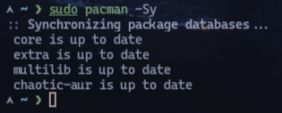
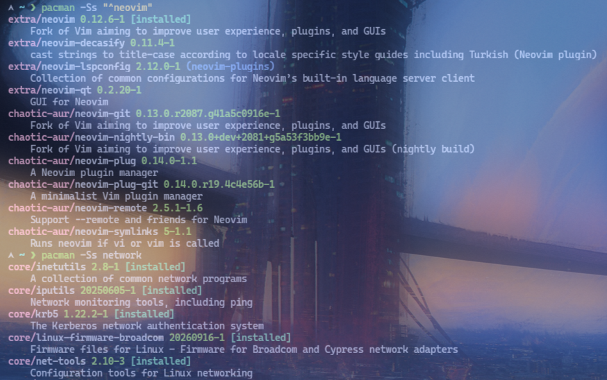
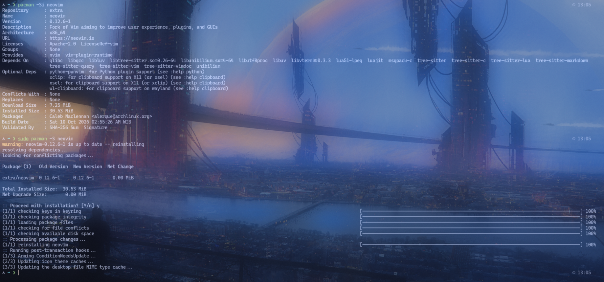
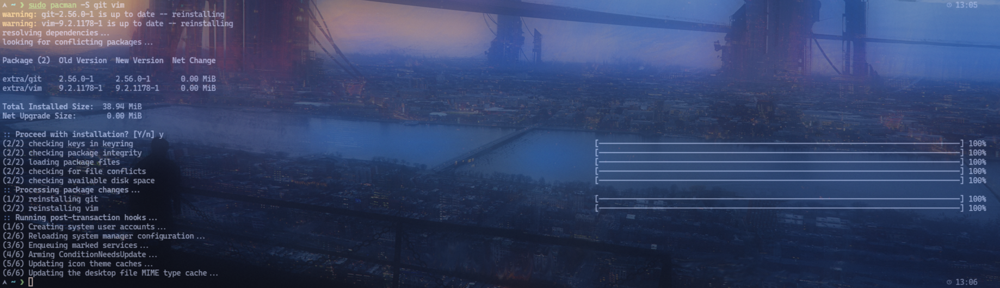
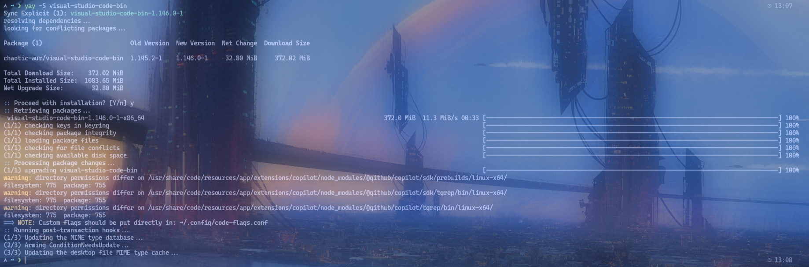
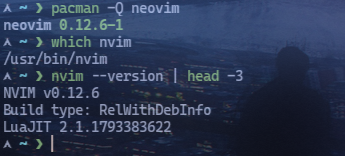
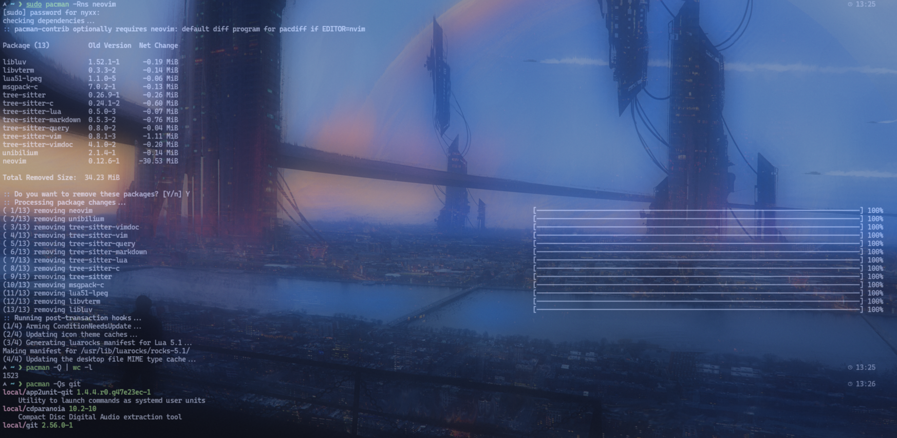

# Lab 01: Package Management

## Objective
Memasang, memperbarui, dan menghapus perangkat lunak dari repositori resmi distribusi, lalu memastikan hasilnya berfungsi.

## Environment
- OS: Arch Linux
- Kernel: 7.2.11-arch1-1
- Shell: zsh
- Package manager: pacman (resmi), yay/paru (AUR)
- User: nyxx (uid 1000, wheel group)

## Practical Implementation
```bash
# 1. Perbarui daftar paket (sync database)
sudo pacman -Sy

# 2. Perbarui semua paket yang terpasang
sudo pacman -Syu

# 3. Cari paket
pacman -Ss git
pacman -Ss "^neovim"
pacman -Ss network

# 4. Informasi paket sebelum install
pacman -Si neovim

# 5. Install paket
sudo pacman -S neovim

# 6. Install beberapa paket sekaligus
sudo pacman -S git vim neovim

# 7. Install dari AUR (yay)
yay -S visual-studio-code-bin

# 8. Verifikasi paket terinstall
pacman -Q neovim
which nvim

# 9. Jalankan untuk bukti berfungsi
nvim --version | head -3

# 10. Hapus paket (tanpa dependensi)
sudo pacman -R neovim

# 11. Hapus paket + dependensi tidak digunakan
sudo pacman -Rns neovim

# 12. Cek paket yang terinstall
pacman -Q
pacman -Q | wc -l

# 13. Cari paket terinstall berdasarkan pattern
pacman -Qs git
```

## Expected Result
- `pacman -Syu` memperbarui semua paket ke versi terbaru.
- `pacman -S neovim` menginstall neovim dari official repository.
- `which nvim` menunjukkan path binary `/usr/bin/nvim`.
- `nvim --version` menampilkan versi neovim.
- `pacman -Rns neovim` menghapus neovim dan dependensi tidak digunakan.

## Analysis
- `pacman -Sy` sinkronisasi database paket (mirror cache).
- `pacman -Syu` sync + upgrade semua paket.
- `pacman -Ss pattern` mencari paket di database (case-insensitive, regex).
- `pacman -Si/Si` menampilkan detail paket (maintainer, dependensi, deskripsi).
- `pacman -S` install, `-R` remove, `-Rns` remove + config + dependensi orfan.
- `yay -S` install dari AUR (Arch User Repository) — butuh `yay` terinstall dulu.
- `pacman -Q` list semua paket terinstall, `-Qs` search di installed list.
- Verifikasi penting: install → `which` → jalankan → cek versi.

## Evidence
Screenshot praktik aslinya sudah tersimpan di folder `evidence/`:
- 
- 
- 
- 
- 
- 
- 

## Conclusion
Praktik successfully menunjukkan siklus hidup paket (`pacman -Syu`, `-S`, `-R`, `-Rns`) dan verifikasi installasi, serta perbedaan official repo vs AUR.