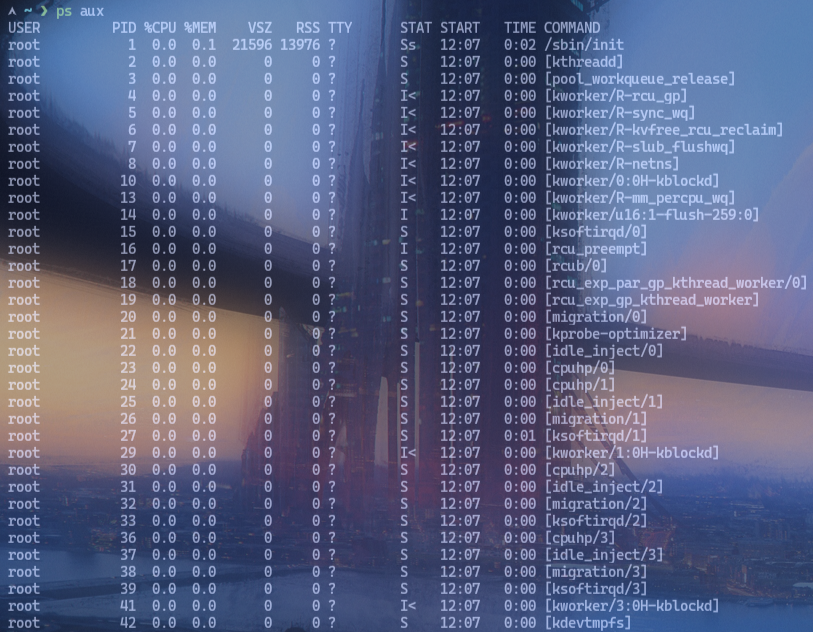
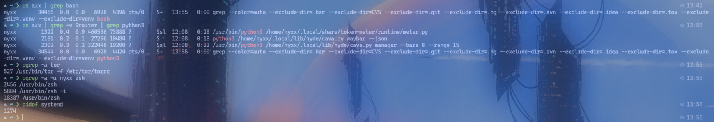
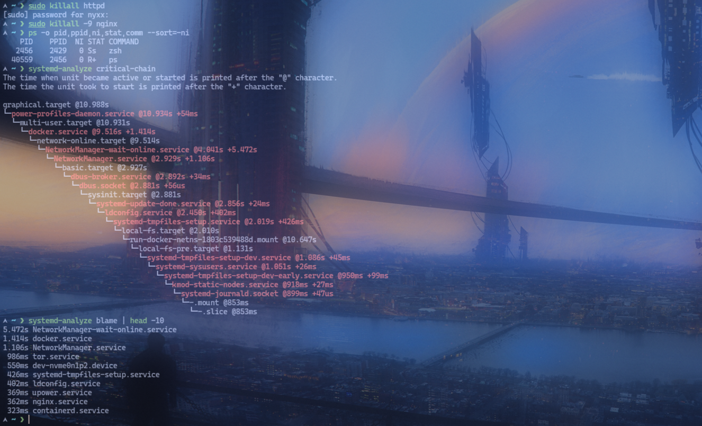

# Lab 02: Process Management

## Objective
Memantau proses yang berjalan dan menghentikan atau mengatur prioritas proses yang bermasalah.

## Environment
- OS: Arch Linux
- Kernel: 7.2.11-arch1-1
- Shell: zsh
- Tools: ps, top, kill, renice, systemd-analyze
- User: nyxx (uid 1000, wheel group)

## Practical Implementation
```bash
# 1. Lihat semua proses
ps aux
ps -ef

# 2. Lihat proses dengan detail
ps aux --sort=-%cpu | head -10
ps aux --sort=-%mem | head -10

# 3. Gunakan top untuk monitoring real-time
top
# Di top: k untuk kill, r untuk renice, q untuk keluar

# 4. Cari proses spesifik
ps aux | grep bash
ps aux | grep -v grep | grep nginx

# 5. Cek PID dari proses
pgrep -a nginx
pgrep -a -u nyxx bash
pidof systemd

# 6. Hentikan proses (graceful)
kill PID
kill -TERM PID

# 7. Hentikan proses (paksa)
kill -9 PID
kill -KILL PID

# 8. Hentikan semua proses berdasarkan nama
killall nginx
killall -9 nginx

# 9. Ubah prioritas proses (renice)
# NI range: -20 (tinggi) ke 19 (rendah)
renice -n -5 -p PID
renice -n 10 -p PID

# 10. Lihat priority dan nice value
ps -o pid,ppid,ni,stat,comm --sort=-ni | head -10

# 11. Jalankan proses di background
sleep 60 &
jobs
# Bring to foreground: fg %1
# Suspended: Ctrl+Z, kill %1

# 12. Analisis systemd (jika ada service bermasalah)
systemd-analyze critical-chain
systemd-analyze blame | head -10
```

## Expected Result
- `ps aux` menampilkan semua proses beserta PID, %CPU, %MEM, dan command.
- `top` menampilkan proses yang paling banyak menggunakan CPU/memory secara real-time.
- `kill -9 PID` menghentikan proses secara paksa.
- `renice -n -5 -p PID` mengubah nice value (priority) proses.
- `sleep 60 &` menjalankan proses di background, `fg %1` mengembalikan ke foreground.

## Analysis
- `ps aux` menampilkan semua user process, `ps -ef` menampilkan hierarchy (parent-child).
- `kill -TERM` (signal 15) graceful shutdown, `kill -9` (signal KILL) paksa — tidak bisa di-block.
- `renice` mengubah nice value: nilai lebih kecil = prioritas lebih tinggi (bisa CPU lebih dulu).
- Default nice value 0, range -20 (max priority) ke 19 (min priority).
- `pgrep` mencari PID berdasarkan pattern nama, `pidof` mencari PID berdasarkan nama binary.
- `killall` mengirim signal ke semua proses dengan nama tertentu.
- Background jobs: `&`, `jobs`, `fg`, `bg`, `kill %N`.

## Evidence
Screenshot praktik aslinya sudah tersimpan di folder `evidence/`:
- 
- 
- 
- 

## Conclusion
Praktik successfully menunjukkan monitoring (`ps`, `top`), penghentian (`kill`, `killall`), dan pengaturan prioritas (`renice`) proses, serta manajemen background jobs.