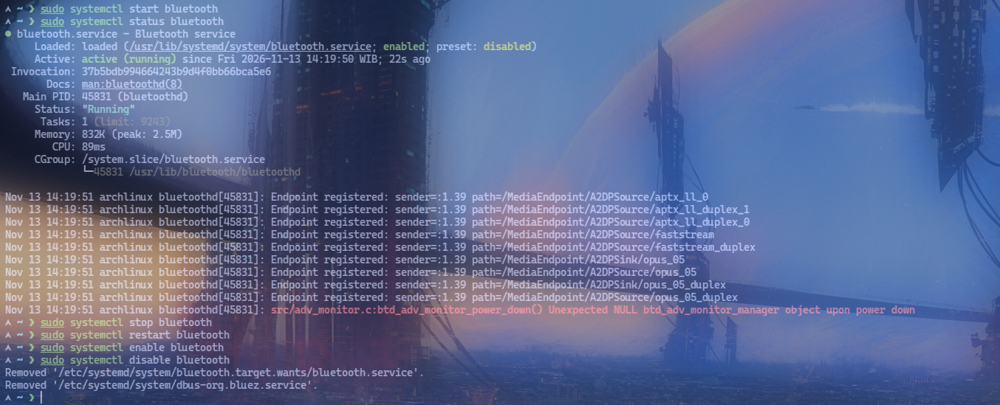

# Lab 03: Service Management

## Objective
Menjalankan, menghentikan, dan mengaktifkan layanan agar tetap berjalan setelah sistem dinyalakan ulang, lalu memverifikasi statusnya.

## Environment
- OS: Arch Linux
- Kernel: 7.2.11-arch1-1
- Init system: systemd 262
- Tools: systemctl, journalctl
- User: nyxx (uid 1000, wheel group — butuh sudo untuk service sistem)

## Practical Implementation
```bash
# 1. Lihat semua service
systemctl list-units --type=service --all --no-pager

# 2. Lihat service yang aktif
systemctl list-units --type=service --state=running --no-pager

# 3. Lihat status service spesifik
systemctl status sshd
systemctl status bluetooth
systemctl status docker

# 4. Mulai service
sudo systemctl start bluetooth

# 5. Hentikan service
sudo systemctl stop bluetooth

# 6. Restart service
sudo systemctl restart bluetooth

# 7. Reload config (tanpa gangguan layanan)
sudo systemctl reload bluetooth

# 8. Enable service (otomatisasi di boot)
sudo systemctl enable bluetooth
sudo systemctl enable --now bluetooth   # enable + start sekaligus

# 9. Disable service (tidak otomatisasi di boot)
sudo systemctl disable bluetooth

# 10. Cek service yang di-enable
systemctl list-unit-files --type=service --state=enabled --no-pager

# 11. Cek status service (ringkas)
systemctl is-active bluetooth
systemctl is-enabled bluetooth

# 12. Lihat log service
journalctl -u bluetooth --no-pager -n 20
journalctl -u bluetooth --since "1 hour ago" --no-pager

# 13. Buat service sederhana (contoh: echo timer service)
sudo systemctl start systemd-timesyncd
systemctl status systemd-timesyncd --no-pager
```

## Expected Result
- `systemctl list-units` menampilkan semua service beserta status (loaded/active/inactive).
- `systemctl start bluetooth` mengaktifkan service bluetooth.
- `systemctl enable bluetooth` mengaktifkan otomatisasi di boot (membuat symlink di `/etc/systemd/system/multi-user.target.wants/`).
- `systemctl is-enabled bluetooth` mengembalikan `enabled`.
- `journalctl -u bluetooth` menampilkan log dari service bluetooth.

## Analysis
- `systemctl start/stop/restart` mengontrol service yang sedang berjalan.
- `systemctl enable/disable` mengatur otomatisasi di boot (symlink ke `multi-user.target.wants/`).
- `systemctl enable --now` enable + start dalam satu perintah.
- `systemctl is-active` cek status running, `systemctl is-enabled` cek status enabled.
- `journalctl -u SERVICE` menampilkan log dari service tersebut.
- Service file berada di `/etc/systemd/system/` atau `/usr/lib/systemd/system/`.
- Format service file: `[Unit]`, `[Service]`, `[Install]` sections.
- User service: `systemctl --user` (tanpa sudo, di `~/.config/systemd/user/`).

## Evidence
Screenshot praktik aslinya sudah tersimpan di folder `evidence/`:
- 
- 
- 
- 
- 

## Conclusion
Praktik successfully menunjukkan pengelolaan service (`systemctl start/stop/enable/disable/status`) dan verifikasi status, beserta akses log melalui `journalctl`.