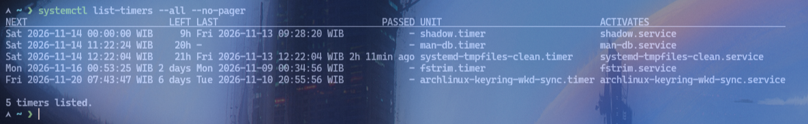
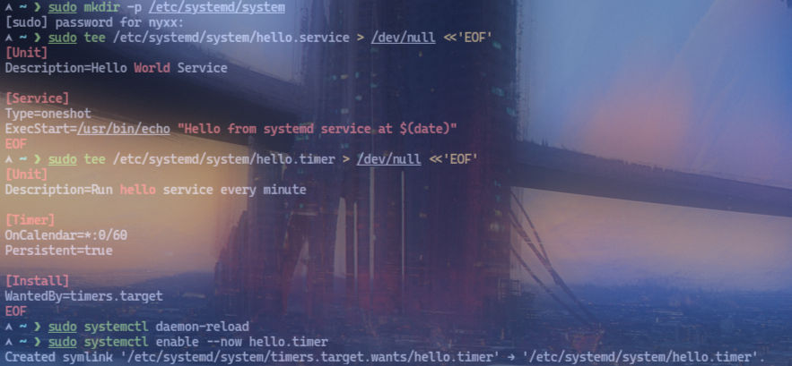
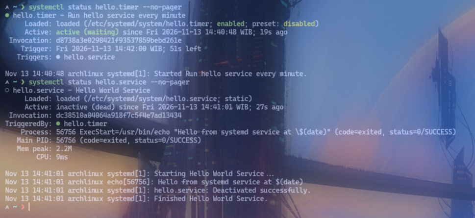

# Lab 04: Task Scheduling

## Objective
Menjadwalkan tugas berulang dan memastikan tugas itu berjalan sesuai jadwal.

## Environment
- OS: Arch Linux
- Kernel: 7.2.11-arch1-1
- Init system: systemd 262
- Tools: systemctl, systemd-analyze, systemd-run
- Catatan: Environment Arch Linux native — **tidak ada cron**, menggunakan systemd timers

## Practical Implementation
```bash
# 1. Lihat semua timer yang ada
systemctl list-timers --all --no-pager

# 2. Buat service sederhana (contoh: echo service)
sudo mkdir -p /etc/systemd/system
sudo tee /etc/systemd/system/hello.service > /dev/null <<'EOF'
[Unit]
Description=Hello World Service

[Service]
Type=oneshot
ExecStart=/usr/bin/echo "Hello from systemd service at $(date)"
EOF

# 3. Buat timer yang menjalankan service setiap 1 menit
sudo tee /etc/systemd/system/hello.timer > /dev/null <<'EOF'
[Unit]
Description=Run hello service every minute

[Timer]
OnCalendar=*:0/60
Persistent=true

[Install]
WantedBy=timers.target
EOF

# 4. Enable dan start timer
sudo systemctl daemon-reload
sudo systemctl enable --now hello.timer

# 5. Cek status timer
systemctl status hello.timer --no-pager
systemctl status hello.service --no-pager

# 6. Tunggu 1 menit, cek log
journalctl -u hello.service --no-pager -n 5

# 7. Hentikan dan disable timer
sudo systemctl stop hello.timer
sudo systemctl disable hello.timer

# 8. Gunakan systemd-run untuk sekali jalan (oneshot)
sudo systemd-run --on-calendar="*:*:00" /usr/bin/echo "Scheduled oneshot at $(date)"

# 9. Gunakan systemd-run untuk task berulang
sudo systemd-run --on-calendar="Fri *:30" /usr/bin/echo "Recurring task"

# 10. Cek timer yang dijadwalkan
systemctl list-timers --all --no-pager

# 11. Alternatif: install cronie (jika ingin menggunakan cron)
# sudo pacman -S cronie
# sudo systemctl enable --now cronie
# crontab -e
```

## Expected Result
- `systemctl list-timers` menampilkan timer yang aktif beserta jadwal berikutnya.
- Timer `hello.timer` berjalan setiap 60 detik dan menjalankan `hello.service`.
- `journalctl -u hello.service` menampilkan output `echo` dari service.
- `systemd-run --on-calendar` menjalankan perintah sesuai jadwal.

## Analysis
- **systemd timers** menggantikan cron di Arch Linux native.
- Timer file: `[Timer]` section dengan `OnCalendar` (jadwal), `Persistent=true` (jalankan kalau terlewat).
- Format `OnCalendar`: `daily`, `hourly`, `*:0/60` (setiap 60 detik), `Mon *:00` (setiap Senin pukul 00:00).
- `systemctl enable --now hello.timer` enable otomatisasi di boot + start sekarang.
- `systemd-run` membuat timer/service satu kali atau berulang secara dinamis.
- **Cronie** tersedia via `pacman -S cronie` jika ingin menggunakan cron tradisional (`crontab -e`).
- Timer activation: timer activates service, service executes command.
- `Persistent=true` ensures missed runs execute on next boot.

## Evidence
Screenshot praktik aslinya sudah tersimpan di folder `evidence/`:
- 
- 
- 
- 

## Conclusion
Praktik successfully menunjukkan penjadwalan tugas berulang menggunakan systemd timers (native Arch) beserta verifikasi melalui `journalctl`, dengan alternatif cronie untuk referensi.